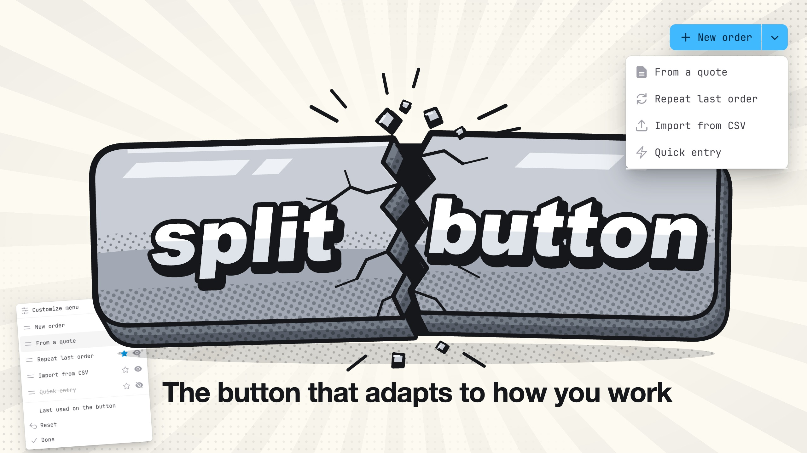

# splitbutton

<p class="filament-hidden">The button that adapts to how you work.</p>

[](https://packagist.org/packages/blemli/splitbutton-for-filament) [](https://github.com/blemli/splitbutton-for-filament/actions?query=workflow%3Atests+branch%3Amain) [](https://packagist.org/packages/blemli/splitbutton-for-filament)

One button for the thing you do most, with its variants one click away: **New order ▾** opens *From a quote*, *Repeat last order*, *Import from CSV*. Entries can be fixed, come from a closure (say, the three most used templates), or be the form presets a user marked as quick create.

Each user then makes the menu their own. A long press on it (or `E`) lets them reorder the entries, hide the ones they never use, and choose which one sits on the button itself; if you allow it, the entry they picked last moves there on its own. Their layout follows them to every device, or stays in the session if you would rather not add a table.

Every entry is an ordinary Filament action inside an `ActionGroup`, so modals, forms, authorization, URLs and key bindings work as they always do, in page headers, tables and forms. The same class also draws the plain "two buttons and a More menu" row.



## Installation

```bash
composer require blemli/splitbutton-for-filament
php artisan splitbutton-for-filament:install -n   # add --run-migrations for ->persist(); remove with splitbutton:uninstall
```

## Usage

```php
SplitButton::make([CreateAction::make(), Action::make('import')])   // first action = the button, the rest = its menu
    ->options(fn () => Template::mostUsed(3)->map(fn ($t) => Action::make("template-{$t->id}")->label($t->name)->url(...)))   // … entries from a closure
    ->editable()            // … users rearrange it: long press the menu (or E) to reorder, hide, pick the default, reset
    ->editHint()            // … a visible "Customize" entry for those who never long press
    ->rememberLastUsed()    // … offers users a "last used on the button" toggle
    ->formSettingsPresets() // … lists formsettings-for-filament presets marked quick create / quick edit
    ->overflow(2)           // … instead: two buttons out front, the rest under "More" (->dropdown(false) groups become sections)
    ->triggerPosition('start')   // … menu trigger first
    ->filterUnauthorized();      // … drop unauthorized entries instead of disabling them

// Everything is opt-in. Panel-wide defaults, and what the per-user features need:
$panel->plugin(SplitButtonPlugin::make()->editable()->rememberLastUsed()->persist());   // persist() = database instead of session
```

Also `CreateAction::make()->split([...])` and `ActionGroup::make([...])->split()` / `->overflow(2)`. Keyboard throughout (`E` edit, `Ctrl ↑↓` move, `H` hide, `D` default), works with [filament-mouseless](https://github.com/blemli/filament-mouseless). English and German, light and dark, Filament 4 and 5.

## License

MIT © [blemli](https://github.com/blemli)
